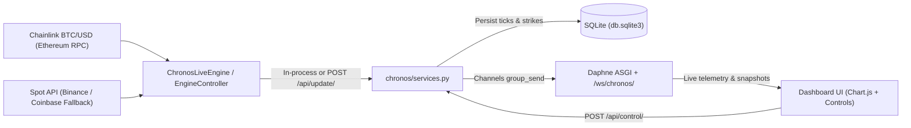

# C.H.R.O.N.O.S. (`C-H-R-O-N-O-S-BC-`)

**Oracle-Spot Arbitrage Command Center & Aave V3 Flash-Loan Prototype**

C.H.R.O.N.O.S. monitors real-time price divergence between Ethereum mainnet's Chainlink BTC/USD oracle and centralized spot exchanges (Binance with automatic Coinbase fallback), streams telemetry over Django Channels WebSockets to a live glassmorphic dashboard, persists scan and strike history in SQLite, and pairs with an atomic Aave V3 flash-loan Solidity contract (`ChronosReaper.sol`).

> **Operational & Safety Notice**
> Live on-chain transaction broadcasting is intentionally disabled in the Python engine. All arbitrage executions triggered by the scanner or dashboard run in **dry-run simulation mode** with modeled Aave V3 flash-loan fees (`0.05%`), DEX slippage, and gas costs. The Solidity contract is provided as a Foundry project for local testing and fork simulation.

---

## Table of Contents

- [Key Features](#key-features)
- [Architecture](#architecture)
- [Project Structure](#project-structure)
- [Quickstart](#quickstart)
- [Configuration (`.env`)](#configuration-env)
- [Running the Scanner](#running-the-scanner)
- [HTTP & WebSocket API Reference](#http--websocket-api-reference)
- [Profit & Fee Model](#profit--fee-model)
- [Smart Contract (`ChronosReaper.sol`)](#smart-contract-chronosreaper-sol)
- [Testing & Verification](#testing--verification)

---

## Key Features

- **Dual-Source Live Price Engine + Synthetic Simulator (`chronos/engine.py`)**
  - Reads Chainlink BTC/USD (`0xF4030086522a5bEEa4988F8cA5B36dbC97BeE88c`) via `latestRoundData()` and `decimals()`, tracking oracle heartbeat age in seconds.
  - Fetches BTC spot price from Binance with automatic fallback to Coinbase on HTTP/regional errors (e.g. HTTP `451`).
  - Tracks signed spread (`SPOT_PREMIUM` vs. `SPOT_DISCOUNT`) as well as absolute drift against your configured trigger threshold.
  - Includes an offline **SIMULATION** mode and on-demand **Dry-Run Strike** trigger for deterministic testing without waiting on mainnet volatility.
- **Real-Time ASGI Dashboard (`chronos/templates/chronos/dashboard.html`)**
  - Powered by Django + Daphne + Channels (`/ws/chronos/`) with automatic `ws:`/`wss:` detection, exponential-backoff reconnect, and `ping`/`pong` keepalive.
  - Dual-view Chart.js surveillance (`Drift %` with trigger threshold line vs. `Spot vs Oracle` price overlay), plus an inline SVG sparkline fallback when offline.
  - Interactive controls to start/pause the background scanner, switch `LIVE` / `SIMULATION` modes, update capital/threshold/poll interval, trigger dry-run strikes, export CSV strike logs, or reset history.
  - Bounded live terminal stream (capped at 150 lines) with level filtering (`All`, `Strikes`, `Warnings`).
- **SQLite Persistence & Admin (`chronos/models.py`, `chronos/admin.py`)**
  - Persists `EngineSettings`, `MarketTick` (bounded to the newest 500 ticks), and `StrikeExecution` audit records so browser reloads retain telemetry and P&L history.
- **Hardened Flash-Loan Receiver (`chronos_contracts/src/ChronosReaper.sol`)**
  - Implements Aave V3 `IFlashLoanSimpleReceiver` (`executeOperation`) with atomic two-leg swaps across Uniswap-V3-compatible `ISwapRouter` contracts.
  - Enforces `msg.sender == address(POOL)` and `initiator == address(this)`, `SafeTransferLib` for non-standard ERC-20s (e.g., USDT), reentrancy guard, `paused` circuit breaker, two-step ownership transfer, and ERC-20/ETH emergency withdrawals.

---

## Architecture



---

## Project Structure

```text
CHRONOS_CORE/
├── .env.example                       # Environment variable template (copy to .env)
├── .gitignore                         # Ignores .env, db.sqlite3, venv/, Foundry build artifacts
├── manage.py                          # Django CLI entrypoint
├── requirements.txt                   # Python dependencies
├── core/
│   ├── asgi.py                        # ProtocolTypeRouter (HTTP + ASGIStaticFilesHandler + WS)
│   ├── settings.py                    # Env-driven Django & Channels settings
│   ├── urls.py                        # Root URL routing
│   └── wsgi.py                        # WSGI fallback entrypoint
├── chronos/
│   ├── admin.py                       # Django Admin registrations
│   ├── consumers.py                   # AsyncWebsocketConsumer (/ws/chronos/)
│   ├── engine.py                      # ChronosLiveEngine & EngineController
│   ├── models.py                      # EngineSettings, MarketTick, StrikeExecution
│   ├── routing.py                     # WebSocket URL patterns
│   ├── services.py                    # Profit breakdown, persistence, Channels broadcasts
│   ├── tests.py                       # Django, API, Engine, and WebSocket test suite
│   ├── urls.py                        # Dashboard & API routes
│   ├── views.py                       # HTTP views, control endpoints, CSV export
│   ├── management/commands/
│   │   └── run_engine.py              # `python manage.py run_engine` CLI command
│   ├── static/chronos/
│   │   ├── css/dashboard.css          # Glassmorphic dark terminal stylesheet
│   │   └── js/dashboard.js            # WebSocket client, Chart.js controller, UI actions
│   └── templates/chronos/
│       └── dashboard.html             # Command center UI template
└── chronos_contracts/
    ├── foundry.toml                   # Foundry compiler & formatter config
    ├── README.md                      # Foundry build/deploy instructions
    ├── script/
    │   └── DeployChronosReaper.s.sol  # Foundry deployment script
    ├── src/
    │   ├── ChronosReaper.sol          # Aave V3 flash-loan receiver contract
    │   ├── interfaces/                # IAaveV3.sol, IERC20.sol, ISwapRouter.sol
    │   └── libraries/                 # SafeTransferLib.sol
    └── test/
        └── ChronosReaper.t.sol        # Foundry unit & security tests
```

---

## Quickstart

### 1. Create a Virtual Environment & Install Dependencies

```powershell
python -m venv venv
.\venv\Scripts\Activate.ps1
pip install -r requirements.txt
```

*(On Linux/macOS, activate with `source venv/bin/activate`.)*

### 2. Configure Environment Variables

```powershell
copy .env.example .env
```

Edit `.env` and set `ALCHEMY_RPC_URL` to a valid Ethereum Mainnet JSON-RPC URL if you intend to use **LIVE** Chainlink oracle reads. (**SIMULATION** mode works offline without an RPC key.)

### 3. Apply Migrations & Launch the Server

```powershell
python manage.py migrate
python manage.py runserver 127.0.0.1:8000 --noreload
```

Open **`http://127.0.0.1:8000/`** in your browser.

---

## Configuration (`.env`)

| Variable | Required | Default | Description |
| --- | --- | --- | --- |
| `ALCHEMY_RPC_URL` | For `LIVE` mode | `""` | Ethereum Mainnet RPC endpoint (Alchemy, Infura, etc.) |
| `DJANGO_SECRET_KEY` | In production | Dev fallback key | Django cryptographic signing key |
| `DJANGO_DEBUG` | No | `True` | Enables debug mode and ASGI static file serving |
| `DJANGO_ALLOWED_HOSTS` | No | `127.0.0.1,localhost,testserver` | Comma-separated allowed hostnames |
| `CHRONOS_API_TOKEN` | No | `""` | Optional shared secret checked via `X-Chronos-Token` on `POST /api/update/` |
| `CHRONOS_SERVER_URL` | No | `http://127.0.0.1:8000/api/update/` | Bridge target when running `chronos/engine.py` standalone |

---

## Running the Scanner

You can drive the scanner in three ways:

1. **Directly from the Dashboard UI:** Click **Start Scanner** in the top bar (or switch **Feed Mode** between `LIVE` and `SIMULATION` in Strategy Parameters).
2. **Via Django Management Command:**
   ```powershell
   python manage.py run_engine
   # Or offline synthetic demo mode / single cycle:
   python manage.py run_engine --simulate --once
   ```
3. **Standalone Microservice Script:**
   ```powershell
   python chronos/engine.py
   ```

---

## HTTP & WebSocket API Reference

| Endpoint | Method | Purpose |
| --- | --- | --- |
| `/` | `GET` | Renders the command center UI and sets the CSRF cookie |
| `/api/state/` | `GET` | Returns current settings, engine status, KPIs, last 40 ticks, and last 25 strikes |
| `/api/control/` | `POST` | CSRF-protected actions: `start`, `stop`, `simulate_strike`, `update_settings`, `reset_history` |
| `/api/update/` | `POST` | Webhook bridge for external engine processes (validates payload & optional `X-Chronos-Token`) |
| `/api/export/strikes.csv` | `GET` | Downloads persisted `StrikeExecution` rows as CSV |
| `/ws/chronos/` | `WS` | Streams `snapshot`, `tick`, `settings_updated`, `engine_status`, `reset`, and `pong` frames |

---

## Profit & Fee Model

Simulated net P&L in [`chronos/services.py`](chronos/services.py) is computed transparently as:

- **Gross Spread Profit:** `capital_usd * (abs(signed_delta_pct) / 100)`
- **Aave V3 Flash-Loan Fee (`0.05%`):** `capital_usd * 0.0005`
- **Modeled DEX Slippage & Gas:** `clamp(capital_usd * 0.00025 + 45.0, min=45.0, max=750.0)`
- **Net Simulated Profit:** `gross - flash_fee - estimated_gas_and_slippage`

Strikes are recorded only when `net_profit > 0`.

---

## Smart Contract (`ChronosReaper.sol`)

[`chronos_contracts/src/ChronosReaper.sol`](chronos_contracts/src/ChronosReaper.sol) implements an Aave V3 `flashLoanSimple` arbitrage receiver:

1. `initiateStrike(asset, amount, arbParams)` (`onlyOwner`, `whenNotPaused`, `nonReentrant`) triggers `POOL.flashLoanSimple`.
2. `executeOperation(...)` verifies `msg.sender == address(POOL)` and `initiator == address(this)`, executes Leg 1 (`asset -> intermediateToken` on `routerBuy`) and Leg 2 (`intermediateToken -> asset` on `routerSell`), resets router allowances to `0`, enforces `finalBalance >= amount + premium + minProfit`, approves `POOL` for repayment, and transfers net profit to `owner`.

---

## Testing & Verification

### Django / Python Test Suite

```powershell
python manage.py check
python manage.py test chronos -v 2
```

Includes 12 automated tests covering models, profit calculations, REST validation, token authentication, CSV export, engine feed fallback/degraded states, and WebSocket `ChronosConsumer` communication.

### Foundry Smart Contract Tests (`chronos_contracts/`)

Requires [Foundry](https://book.getfoundry.sh/getting-started/installation) (`forge`):

```shell
cd chronos_contracts
forge build --sizes
forge test -vvv
```
